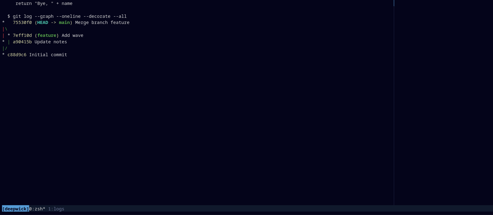

# Deepwick for tmux

Deepwick colors for tmux: status bar, windows, pane borders, messages, copy
mode, popups, and menus. Only styles are set — your status bar contents stay
as they are.

> Deepwick is an unofficial theme derived from
> [Polywick Blue](https://vscode.polywickstudio.net) by Polywick Studio (MIT).
> Not affiliated with Polywick Studio.



## Install

With [TPM](https://github.com/tmux-plugins/tpm), add to `~/.tmux.conf`:

```tmux
set -g @plugin 'deepwick/tmux'
```

and press `prefix` + `I`. Without TPM:

```tmux
source-file /path/to/deepwick.conf
```

For true colors, make sure your terminal is advertised as RGB-capable, for
example `set -as terminal-features ',xterm-256color:RGB'`.

Tested with tmux 3.7c.

## License

MIT. See [LICENSE](LICENSE).
